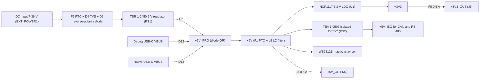
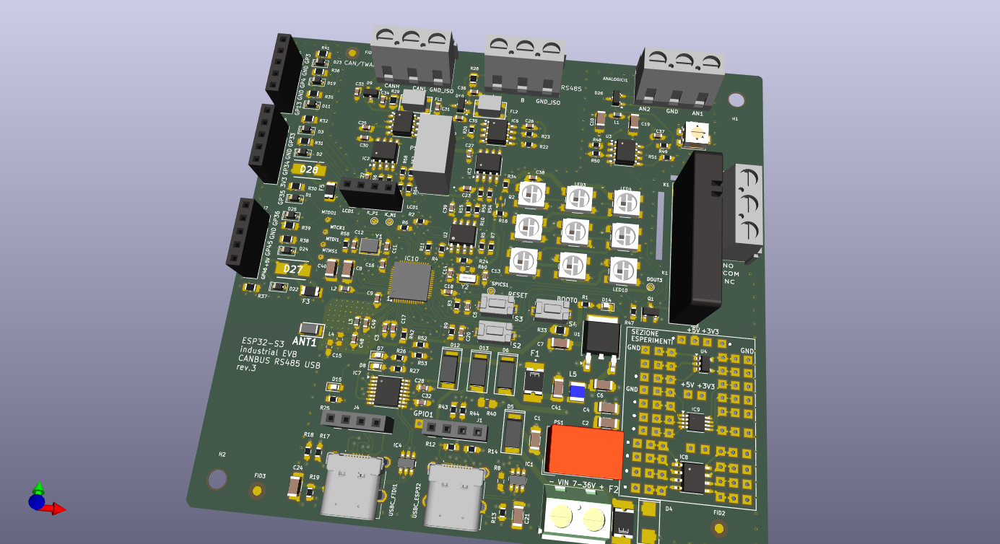

# ESP32-S3 Industrial Development Board — rev. 3

An ESP32-S3 development board with industrial-style I/O: an **isolated CAN bus** port, an **isolated RS-485** port, a **relay output**, two **0–30 V analog inputs**, **nine ESD-protected GPIOs**, a **3 × 3 RGB LED matrix** and a **prototyping area**. It runs from a **7–36 V DC** supply or from either of its two USB-C ports. Everything fits on a 99 × 94 mm four-layer PCB designed in KiCad 10.

  

## Features

- **Espressif ESP32-S3FN8**: dual-core Xtensa LX7 MCU, 2.4 GHz Wi-Fi and Bluetooth LE, 8 MB in-package flash, on-board chip antenna
- **Two USB-C ports**:
  - **debug USB**: FTDI FT230X USB-to-UART bridge on UART0
  - **native USB**: ESP32-S3 USB Serial/JTAG and USB OTG
- **Isolated CAN bus** (ESP32-S3 TWAI controller): Microchip MCP2562 transceiver, 120 Ω termination
- **Isolated RS-485**: MAX13488E half-duplex transceiver with automatic direction control, 120 Ω termination and fail-safe bias
- **Galvanic isolation** for both buses: ADuM3201 digital isolators and a Traco TEA 1-0505 isolated DC/DC converter
- **3 × 3 WS2812B RGB LED matrix** with a 3.3 V → 5 V level shifter on the data line
- **SPDT relay** (Finder 34.51, 6 A contacts) on a screw terminal block
- **Two analog inputs, 0–30 V**: resistor divider and op-amp buffer for each input
- **Nine ESD-protected GPIOs** on three 2.54 mm headers, with fused 3.3 V and 5 V outputs
- **Header for an SSD1306 I²C OLED display**
- **Wide-range supply**: 7–36 V DC input with reverse-polarity, overcurrent and transient protection, switching regulator to 5 V
- **Prototyping area** with through-hole pads and footprints for SOIC-8, MSOP-8 and SOT-23-5 parts
- **Reset, boot and user push buttons**, user LED, potentiometer on an ADC input
- **JTAG test points** and stitching vias along the board perimeter

## Block diagram

  

Power tree:

## Circuit description

The full schematic is available as a PDF file: [ESP32_ind_EVB_V3_schematic.pdf](production/ESP32_ind_EVB_V3_schematic.pdf)

| Sheet | File | Content |
|---|---|---|
| Root | `ESP32_ind_EVB_V3.kicad_sch` | Block diagram |
| gerarchico | `gerarchico.kicad_sch` | Hierarchy sheet that links the sub-sheets below |
| Power | `power.kicad_sch` | DC input, protection, 5 V switching regulator, 3.3 V LDO, fused header supplies |
| ESP32-S3 MCU | `mcu_sch.kicad_sch` | ESP32-S3, crystals, antenna, SPI flash, native USB-C, buttons, OLED header |
| bus | `bus_sch.kicad_sch` | Debug USB-C and FT230X, isolated CAN bus and RS-485, isolated DC/DC |
| GPIO | `GPIO_sch.kicad_sch` | Protected GPIO headers, analog inputs, relay, potentiometer |
| LED_MATRIX_WS2812B | `LED_MATRIX_WS2812B.kicad_sch` | 3 × 3 WS2812B matrix and level shifter |
| breadboard | `breadboard_sch.kicad_sch` | Prototyping area |

### Power supply (Power sheet)

The board has three power sources. Schottky diodes (Comchip CDBA340, 40 V / 3 A) combine them on the `+5V_PRO` node, so any of them can power the board:

| Source | Path to `+5V_PRO` |
|---|---|
| DC input `EXT_POWER1`, 7–36 V | **F2** (PTC, 1.5 A hold) → **D4** (SMBJ36CA bidirectional TVS) → **D5** (reverse-polarity diode) → **PS1** (Traco TSR 1-2450, 5 V / 1 A switching regulator) → **D6** |
| Debug USB-C (`USBC_FTDI1`) | VBUS → **D12** |
| Native USB-C (`USBC_ESP32`) | VBUS → **D13**. R40 (0 Ω, not fitted) can bypass the diode |

From `+5V_PRO`:

- **F1** (PTC, 1.5 A hold) and an LC filter (**L5**, Murata 4.7 µH, with C41 and C6) make the **+5V** rail. It feeds the LED matrix, the relay coil, the isolated DC/DC converter and the 5 V header pin.
- **U1** (onsemi NCP1117, 3.3 V LDO) makes the **+3V3** rail from +5V through **R33** (0 Ω, 0.5 W). Remove R33 to isolate the 3.3 V loads or to measure their current.
- Two ferrite beads (BLM18AG102) separate the analog supplies:
  - L1 feeds **+3.3VA** (op-amp and potentiometer).
  - L2 feeds the ESP32-S3 `VDDA` pins.
- The header supply pins are protected by 0.5 A PTC fuses and TVS diodes:
  - `+5V_OUT`: F3 and D27 (SMBJ5.0A)
  - `+3V3_OUT`: F5 and D28 (SMBJ3V3)
- **D14** shows that the 3.3 V rail is on.

> **Note:** when the board runs from USB, the +5V rail is one Schottky diode drop below VBUS.

### ESP32-S3 microcontroller (ESP32-S3 MCU sheet)

- **IC10** is an **Espressif ESP32-S3FN8** with 8 MB of in-package flash.
- **Clocks**:
  - **Y1** (Diodes FL4000157Z) is the 40 MHz main crystal, with C11 and C12 (20 pF).
  - **Y2** (Abracon ABS07AIG) is the 32.768 kHz RTC crystal on GPIO15/GPIO16, with C13 and C14 (30 pF).
- **Antenna**: **ANT1** (Walsin RFANT3216120A5T) is a 2.4 GHz chip antenna. A π matching network sits between it and the `LNA_IN` pin: L3 (2.4 nH), C48 and C49 (1.8 pF). C15 and L4 are not fitted.
- **Reset**: **S3** pulls `CHIP_PU` low. R3 and R42 (100 kΩ) pull it up, and C5 (1 µF) delays the start-up after power-on.
- **Boot and user buttons**:
  - **S4** (BOOT) is on GPIO0.
  - **S2** (user button) is on GPIO2, with a 100 kΩ pull-up (R9) and a 100 nF debounce capacitor (C20).
- **User LED**: **D15** with a 470 Ω resistor (R25). See [Known issues](#known-issues-rev-3) for its GPIO.
- **External SPI flash**: **U2** (Winbond W25Q80DV, 8 Mbit) is connected to the SPI flash bus through the 0 Ω links R2, R6, R7, R10 and R11.
- **Native USB**:
  - The USB-C receptacle **USBC_ESP32** connects to GPIO19 (D−) and GPIO20 (D+) through **IC1** (ST USBLC6-2SC6 ESD protection).
  - R12 and R14 (5.1 kΩ) pull CC1 and CC2 down, so the board is seen as a USB device.
  - The connector shield goes to GND through R13 (1 MΩ) in parallel with C21 (3.3 nF / 1 kV).
  - Header **J1** (+5V, D−, D+, GND) carries the same port, through R43/R44 (0 Ω), for a panel-mount USB connector.
- **I²C**: GPIO5 (SCL) and GPIO6 (SDA) go through 0 Ω links (R63, R64) and have 1.5 kΩ pull-ups (R67, R68). The 4-pin header **LCD1** (GND, 3V3, SCL, SDA) accepts an SSD1306 OLED module.

### USB debug port (bus sheet)

- **IC7** (FTDI **FT230XS**) is a USB-to-UART bridge connected to the ESP32-S3 UART0 through R52/R53 (0 Ω):
  - FT230X `TXD` → GPIO44 (`U0RXD`)
  - FT230X `RXD` ← GPIO43 (`U0TXD`)
- It runs from the VBUS of its own USB-C port (**USBC_FTDI1**), and its internal 3.3 V regulator sets the I/O level.
- **IC4** (USBLC6-2SC6) protects the data lines. R17 and R18 (5.1 kΩ) pull CC1 and CC2 down. The shield goes to GND through R19 (1 MΩ) in parallel with C24 (3.3 nF / 1 kV).
- **D7** and **D8** are the serial activity LEDs, driven by the FT230X `CBUS2` and `CBUS1` pins.
- Header **J4** (GND, D+, D−, VBUS) carries the same port for a panel-mount USB connector.
- The FT230X `RTS#` and `CTS#` lines are not connected, so there is no automatic reset into the bootloader. Use the BOOT button (see [Programming](#programming)).

### Isolated CAN bus and RS-485 (bus sheet)

Both buses sit in a common isolated domain:

- **PS2** (Traco TEA 1-0505) is a 1 W isolated DC/DC converter. It makes `+5V_ISO` / `GND_ISO` from +5V.
- **IC2** (CAN) and **IC3** (RS-485) are Analog Devices **ADuM3201** dual-channel digital isolators. Their MCU side runs from +3V3 and their bus side from `+5V_ISO`.
- CAN and RS-485 share the same `GND_ISO`. They are isolated from the MCU, but not from each other.

| | **CAN bus** | **RS-485** |
|---|---|---|
| MCU pins | GPIO37 TX, GPIO38 RX (TWAI controller), through R57/R56 (0 Ω) | GPIO17 TX, GPIO18 RX (UART1), through R54/R55 (0 Ω) |
| Isolator | IC2 | IC3 |
| Transceiver | **IC5**, Microchip MCP2562. `STBY` is tied low through R21, so it is always active | **IC6**, MAX13488E, half-duplex with AutoDirection: no direction pin is needed |
| Termination | R29, 120 Ω (fitted) | R28, 120 Ω (fitted) |
| Fail-safe bias | – | R22 / R23 (1 kΩ) on A / B |
| Common-mode choke | FL1, TDK ACT45B-101-2P | FL2, TDK ACT45B-101-2P |
| ESD protection | D9, Nexperia PESD2CANFD27L | D10, Nexperia PESD2CANFD27L |
| Filter capacitors | C33, C34 (100 pF to `GND_ISO`), C31 (100 pF between CANH and CANL) | C35, C36 (100 pF to `GND_ISO`) |
| Terminal block | **CAN1**: 1 CANH, 2 CANL, 3 GND_ISO | **RS1**: 1 A, 2 B, 3 GND_ISO |

> **Note:** the termination resistors are always fitted. If the board is not at one end of the bus, remove R29 (CAN) or R28 (RS-485).

### RGB LED matrix (LED_MATRIX_WS2812B sheet)

- **LED2–LED10** are nine **WS2812B** addressable RGB LEDs in a 3 × 3 matrix, powered from +5V. The colour order is GRB.
- GPIO14 drives the data line through **Q2** (Diodes DMG1012T), an N-MOSFET level shifter from 3.3 V to 5 V. R16 (2.2 kΩ) pulls the 3.3 V side up and R34 (4.7 kΩ) pulls the 5 V side up.
- Test point **DOUT3** is the data output of the last LED. Use it to extend the chain.

### Protected GPIO, analog inputs and relay (GPIO sheet)

**Protected GPIO**

Nine GPIOs have a 49.9 Ω series resistor (R30–R32, R35–R39, R41) and an ESD7351 protection diode (D1–D3, D11, D19, D22–D25). They are available on three 1 × 5 female headers, 2.54 mm pitch:

| Pin | J5 | J6 | J7 |
|---|---|---|---|
| 1 | GPIO3 | GPIO33 | GPIO36 |
| 2 | GND | GND | GND |
| 3 | GPIO4 | GPIO34 | GPIO46 ¹ |
| 4 | GND | +3V3_OUT (F5, 0.5 A) | +5V_OUT (F3, 0.5 A) |
| 5 | GPIO13 | GPIO35 | GPIO45 ¹ |

¹ The silkscreen labels of these two pins are swapped. See [Known issues](#known-issues-rev-3).

> **Note:** GPIO3, GPIO45 and GPIO46 are ESP32-S3 strapping pins. Do not drive them, or pull them up, while the board resets.

**Analog inputs**

- Terminal block **ANALOGICI1**: 1 AN2, 2 GND, 3 AN1.
- Each input has a 47 kΩ / 4.7 kΩ divider (ratio 1 : 11), followed by one half of **U3** (TI LMV358) wired as a voltage follower:
  - AN1 → GPIO12 (`ADC2_CH1`)
  - AN2 → GPIO11 (`ADC2_CH0`)
- A 30 V input gives about 2.7 V at the ADC. The input voltage is `V_in = V_adc × 11`.
- The op-amp runs from +3.3VA, so its output cannot go above the ADC supply.
- **D26** (PESD2CANFD27L) protects both inputs against ESD.

> **Note:** on the ESP32-S3 the ADC2 unit is shared with the Wi-Fi driver. Check the ESP-IDF ADC documentation if you read AN1 and AN2 while Wi-Fi is active.

**Potentiometer**

**RV1** (10 kΩ, Bourns 3314G) is connected between GND and +3.3VA. Its wiper goes to GPIO10 (`ADC1_CH9`), which is useful to test the ADC.

**Relay**

- **K1** (Finder 34.51) is an SPDT relay with a 5 V coil, powered from +5V.
- GPIO21 drives it through R47 (0 Ω) and **Q1** (Diodes DRDC3105F), a relay driver with built-in bias resistors and flyback diode.
- The contacts are on terminal block **RELE1**: 1 NO, 2 COM, 3 NC.

### Prototyping area (breadboard sheet)

The area marked *SEZIONE ESPERIMENTI* on the silkscreen has through-hole pads on a grid, with GND, +5V and +3V3 pads at the edges. It also has three SMD footprints with every pin brought out to a pad:

- **IC8**: SOIC-8 (NE555 in the BOM)
- **IC9**: MSOP-8 (NE555 in the BOM)
- **U4**: SOT-23-5 (NCP718 LDO in the BOM)

### GPIO map

| GPIO | Function |
|---|---|
| GPIO0 | BOOT button S4 |
| GPIO1 | Test pad TP72 |
| GPIO2 | User button S2 |
| GPIO3, GPIO4, GPIO13 | Protected GPIO, header J5 |
| GPIO5 / GPIO6 | I²C SCL / SDA (OLED header LCD1) |
| GPIO9 | User LED D15 (rev. 3 PCB, see [Known issues](#known-issues-rev-3)) |
| GPIO10 | Potentiometer RV1 (`ADC1_CH9`) |
| GPIO11 / GPIO12 | Analog inputs AN2 / AN1 (`ADC2_CH0` / `ADC2_CH1`) |
| GPIO14 | WS2812B LED matrix data |
| GPIO15 / GPIO16 | 32.768 kHz crystal |
| GPIO17 / GPIO18 | RS-485 TX / RX (UART1) |
| GPIO19 / GPIO20 | Native USB D− / D+ |
| GPIO21 | Relay K1 |
| GPIO26 | Test point SPICS1 |
| GPIO33, GPIO34, GPIO35 | Protected GPIO, header J6 |
| GPIO36, GPIO45, GPIO46 | Protected GPIO, header J7 |
| GPIO37 / GPIO38 | CAN TX / RX (TWAI) |
| GPIO39–GPIO42 | JTAG test points MTCK, MTDO, MTDI, MTMS |
| GPIO43 / GPIO44 | UART0 TX / RX to the FT230X (debug USB) |
| GPIO47 / GPIO48 | Test points K_N1 / K_P1 |

### Indicators, buttons and test points

| Ref | Function |
|---|---|
| D14 | 3.3 V rail on |
| D15 | User LED |
| D7, D8 | FT230X serial activity |
| S2 | User button (GPIO2) |
| S3 | RESET (`CHIP_PU`) |
| S4 | BOOT (GPIO0) |
| MTCK1, MTDO1, MTDI1, MTMS1 | JTAG |
| DOUT3 | Data output of the LED matrix |
| SPICS1, K_P1, K_N1, TP72 | GPIO26, GPIO48, GPIO47, GPIO1 |

## Main components

| Ref | Part | Function |
|---|---|---|
| IC10 | Espressif ESP32-S3FN8 | Dual-core MCU, Wi-Fi + Bluetooth LE, 8 MB flash |
| Y1 | Diodes FL4000157Z | 40 MHz crystal |
| Y2 | Abracon ABS07AIG-32.768KHZ | 32.768 kHz RTC crystal |
| ANT1 | Walsin RFANT3216120A5T | 2.4 GHz chip antenna |
| U2 | Winbond W25Q80DVSNIG | 8 Mbit SPI NOR flash |
| IC7 | FTDI FT230XS-R | USB ⇄ UART bridge (debug port) |
| IC1, IC4 | ST USBLC6-2SC6 | ESD protection for the USB data lines |
| IC5 | Microchip MCP2562-E/SN | CAN transceiver |
| IC6 | Analog Devices MAX13488EESA+ | RS-485 transceiver with AutoDirection |
| IC2, IC3 | Analog Devices ADuM3201ARZ | Dual-channel digital isolators |
| PS2 | Traco TEA 1-0505 | 1 W isolated DC/DC converter, 5 V → 5 V |
| PS1 | Traco TSR 1-2450 | 5 V / 1 A switching regulator |
| U1 | onsemi NCP1117, 3.3 V, TO-252 | 3.3 V LDO regulator |
| U3 | TI LMV358IDR | Dual op-amp, analog input buffers |
| Q1 | Diodes DRDC3105F-7 | Relay driver |
| K1 | Finder 34.51 | SPDT relay, 5 V coil, 6 A contacts |
| Q2 | Diodes DMG1012T | N-MOSFET, LED data level shifter |
| LED2–LED10 | WS2812B | Addressable RGB LEDs |
| FL1, FL2 | TDK ACT45B-101-2P-TL003 | Common-mode chokes for CAN and RS-485 |
| D9, D10, D26 | Nexperia PESD2CANFD27L | ESD protection for CAN, RS-485 and analog inputs |
| D1–D3, D11, D19, D22–D25 | onsemi ESD7351HT1G | ESD protection for the GPIOs |
| D4 | SMBJ36CA | Bidirectional TVS on the DC input |
| D27, D28 | SMBJ5.0A, SMBJ3V3 | TVS on the header supply pins |
| D5, D6, D12, D13 | Comchip CDBA340-HF | Schottky diodes: reverse polarity and OR-ing |
| F1, F2 | Littelfuse 1812L150/24MR | PTC resettable fuses, 1.5 A hold |
| F3, F5 | Littelfuse 1206L050/15YR | PTC resettable fuses, 0.5 A hold |
| L5 | Murata DFE322512F-4R7M | 4.7 µH inductor, +5V filter |
| S2, S3, S4 | Panasonic EVQ-PE104K | Push buttons |
| USBC_ESP32, USBC_FTDI1 | CUI UJ31-CH-G2-SMT-TR | USB Type-C receptacles |
| CAN1, RS1, ANALOGICI1, RELE1 | TE 282837-3 | 3-pole terminal blocks, 5.08 mm |
| EXT_POWER1 | TE 282837-2 | 2-pole terminal block, 5.08 mm |

The complete bill of materials is in [`bom.csv`](production/bom.csv). An interactive BOM is in [`ESP32-S3 ind_EVB rV3ibom.html`](production/ESP32-S3%20ind_EVB%20rV3ibom.html): download it and open it in a browser.

## PCB

  

| Parameter | Value |
|---|---|
| Layers | 4 (F.Cu, In1.Cu GND plane, In2.Cu GND plane, B.Cu) |
| Board size | 99.3 × 94.2 mm |
| Mounting | 2 × M3 holes (H1, H2) |
| Supply | 7–36 V DC on a terminal block, or 5 V from either USB-C port |
| Connectors | 2 × USB-C, 4 × 3-pole and 1 × 2-pole 5.08 mm terminal blocks, 3 × 1×5 GPIO headers, 1 × 4-pin OLED header, 2 × 4-pin USB headers |
| EDA tool | KiCad 10.0 |

## Repository contents

| Path | Description |
|---|---|
| `hardware/ESP32_ind_EVB_V3.kicad_pro` | KiCad 10 project file |
| `hardware/ESP32_ind_EVB_V3.kicad_sch` and sub-sheets | Hierarchical schematic (see the sheet table above) |
| `hardware/ESP32_ind_EVB_V3.kicad_pcb` | PCB layout |
| `hardware/lib/` | Project libraries: symbols (`ESP32indEVB.kicad_sym`), footprints (`ESP32indEVB.pretty`) and 3D models (`3dmodels`) |
| `production/gerber ESP32_ind_EVB_V3.zip` | Gerber manufacturing files |
| `production/bom.csv`, `designators.csv`, `positions.csv` | Bill of materials and pick-and-place files |
| `production/netlist.ipc` | IPC-D-356 netlist |
| `production/ESP32_ind_EVB_V3_schematic.pdf` | Schematic |
| `production/ESP32-S3 ind_EVB rV3ibom.html` | Interactive BOM |
| `firmware/` | Arduino examples |
| `docs/` | Pictures used in this README |

The project is self-contained: the libraries in `hardware/lib/` are linked through the project library tables, so you do not need to install any external library.

## Programming

The examples use the Arduino IDE with the **esp32** board package by Espressif Systems.

1. In **Tools**, select these settings (see the [screenshot](firmware/board%20configuration.png)):
   - Board: **ESP32-S3-USB-OTG**
   - USB Mode: **USB-OTG**
   - Upload Mode: **UART0 / Hardware CDC**
   - Port: the COM port of the board
2. Put the ESP32-S3 in download mode. Press and hold **BOOT** (S4) before you plug in the USB cable, and release it a few seconds after plugging it in. If the board is already powered, hold BOOT, press and release RESET (S3), then release BOOT.
3. Upload the sketch, then press **RESET** to run it.

| Example | Description |
|---|---|
| [`TWAItransmit`](firmware/TWAItransmit) | Sends CAN frames at 500 kbit/s (TWAI, TX GPIO37, RX GPIO38) |
| [`TWAIreceive`](firmware/TWAIreceive) | Receives CAN frames at 500 kbit/s in listen-only mode |
| [`RS485_TX`](firmware/RS485_TX) | Sends data on RS-485 at 9600 baud (UART on GPIO17/GPIO18) |
| [`rs485_RX`](firmware/rs485_RX) | Receives data on RS-485 at 9600 baud |
| [`random_generator_LEDS`](firmware/random_generator_LEDS) | Fades the LED matrix through random colours (FastLED, GPIO14) |
| [`fastLED_webserver`](firmware/fastLED_webserver) | Web page that sets the colour and brightness of the LED matrix over Wi-Fi. Enter your network name and password in the sketch |

## Known issues (rev. 3)

- **GPIO45 / GPIO46 labels swapped**: the schematic net labels, and so the silkscreen of header J7, are swapped. Pin 3, labelled GP45, is connected to **GPIO46**. Pin 5, labelled GP46, is connected to **GPIO45**. The tables in this README show the real GPIO numbers.
- **User LED D15**: the schematic connects it to GPIO7, but the rev. 3 PCB routes it to **GPIO9**.

## Revision history

- **rev. 3**: some nets renamed, stitching vias added along the board perimeter.
- **rev. 2**: previous version.

## License and contact

Reproducing this board for mass production or for commercial purposes is **not allowed**. For business proposals, write to info@pcbsemplice.com.

For questions, feedback or suggestions, write to info@pcbsemplice.com.

If you are interested in these projects and want to support the development of boards, open-source projects, prototypes and documentation, you can make a donation on [PayPal](https://shorturl.at/0LquK). Every contribution, however small, makes a difference. Thank you!

If you speak Italian and you are starting with KiCad, have a look at the [KiCadSemplice](https://www.pcbsemplice.com/kicad) course. If you want to design professional circuits, the personalised *pcb-pro-accademy* course is also available.

## Author

Designed by **Gabriele Marocco**, [PCB Semplice](https://pcbsemplice.com).
